# SafeCam AI Assistant

## 1. Y tuong cot loi

SafeCam AI Assistant la tro ly AI ho tro tim kiem va phan tich su kien trong du lieu camera an ninh. Nguoi dung khong can tua video thu cong theo gio, ma co the hoi bang ngon ngu tu nhien tieng Viet, vi du:

- "Tim nguoi mac ao den di vao cong sau 20h."
- "Xe may mau do xuat hien khi nao?"
- "Tom tat cac su kien bat thuong sau 22h."

He thong tra ve doan video dung thoi diem, anh minh chung, mo ta su kien, diem tin cay va ly do ket qua duoc chon.

## 2. Van de can giai quyet

Camera an ninh tao ra luong du lieu multimedia rat lon. Khi can truy vet mot su kien, bao ve hoac quan ly thuong phai xem lai nhieu gio video. Cach lam nay cham, de bo sot chi tiet va kho mo rong khi co nhieu camera.

Voi boi canh Viet Nam, bai toan con co cac dac thu rieng:

- Nhieu xe may, mu bao hiem, bai xe va cong ra vao.
- Bien hieu, dong phuc, bien so va ngon ngu tieng Viet.
- Anh sang phuc tap, video mo, goc camera co dinh.
- Nguoi dung thuong chi nho mo ta, khong nho timestamp chinh xac.

## 3. Pham vi MVP trong repo nay

Repo nay trien khai ban MVP co the chay demo bang Docker:

- Upload video camera mau.
- Tu dong tach video thanh clip ngan theo `CLIP_SECONDS`.
- Trich thumbnail bang FFmpeg.
- Tao caption/metadata local nhe cho moi clip.
- Tao embedding va luu vao PostgreSQL + pgvector.
- Tim kiem vector theo cau hoi tieng Viet.
- Hien thi ket qua tren React dashboard kem timestamp, thumbnail, clip va ly do.

MVP hien tai uu tien kien truc va luong du lieu dau cuoi. Lop phan tich hinh anh dang la adapter local nhe, co the thay bang YOLO, CLIP, BLIP, Qwen-VL, LLaVA hoac GPT Vision ma khong can doi schema API/database.

## 4. Kien truc

```mermaid
flowchart LR
    A["Video upload / Camera source"] --> B["FastAPI ingest"]
    B --> C["FFmpeg split clips + thumbnails"]
    C --> D["Frame analyzer / VLM adapter"]
    D --> E["Caption + objects + attributes"]
    E --> F["Hashing embedding"]
    F --> G["PostgreSQL + pgvector"]
    H["React dashboard"] --> I["Search API"]
    I --> J["Vietnamese query parser"]
    J --> G
    G --> K["Ranked evidence"]
    K --> H
```



## 5. Thiet ke du lieu chinh

Moi clip video duoc luu voi cau truc:

```json
{
  "clip_id": "uuid",
  "camera_id": "uuid",
  "location": "Cong chinh",
  "start_second": 20,
  "end_second": 30,
  "objects": ["person", "motorbike"],
  "attributes": {
    "dominant_color": "black",
    "brightness": "trung binh"
  },
  "caption": "Doan 20-30s tai Cong chinh...",
  "thumbnail_path": "thumbnails/clip.jpg",
  "clip_path": "clips/clip.mp4",
  "embedding": "vector(384)"
}
```

## 6. Cac module da co

- `backend/app/api`: REST API cho camera, video, clip, search, report.
- `backend/app/models`: SQLAlchemy models cho PostgreSQL.
- `backend/app/services/video_processor.py`: pipeline FFmpeg.
- `backend/app/services/embedding.py`: embedding hashing deterministic cho MVP.
- `backend/app/services/search.py`: truy van pgvector va xep hang ket qua.
- `frontend/src`: dashboard React upload/search/evidence viewer.
- `docker-compose.yml`: db + api + web.

## 7. Huong nang cap AI

Cac diem nen nang cap khi co GPU/API key:

1. Thay `FrameAnalyzer` bang YOLOv8/YOLOv11 de phat hien person, motorbike, helmet, bag, plate.
2. Them VLM captioning bang Qwen-VL, LLaVA, BLIP hoac GPT Vision.
3. Thay `HashingEmbedding` bang CLIP embedding hoac sentence-transformers da ngon ngu.
4. Them OCR cho bien so/bien hieu va Whisper cho am thanh.
5. Them face/plate blur, RBAC va audit log de dap ung quyen rieng tu.

## 8. Tieu chi demo

- Upload video 1-5 phut.
- Pipeline tao clip trong database.
- Truy van tieng Viet tra ve top-k ket qua.
- Ket qua co thumbnail, clip, timestamp, caption, score va reason.
- Co the chay bang mot lenh Docker.

