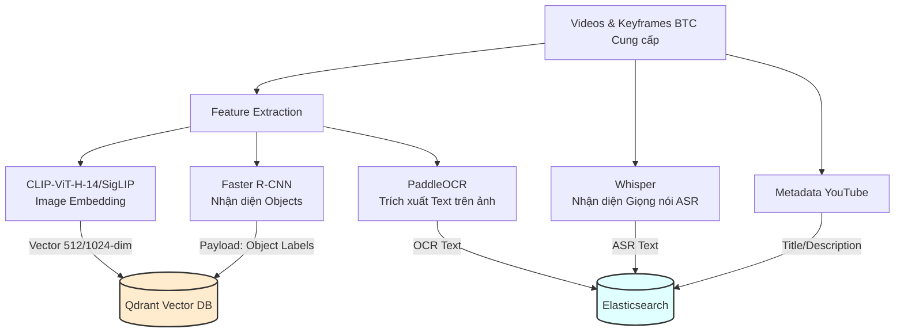
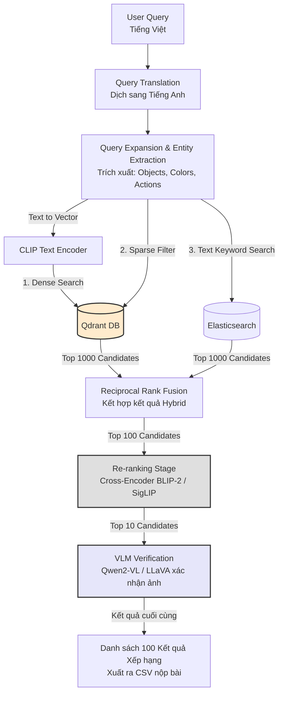

# AIC 2026 Video Retrieval System

Hệ thống AI tìm kiếm và truy xuất sự kiện trong video đa phương thức, được thiết kế và tối ưu riêng cho cuộc thi **Hội thi Thử thách Trí tuệ Nhân tạo TP.HCM năm 2026 (AIC 2026)**.
---

## 1. Mục tiêu giải quyết (Theo đề thi AIC 2026)

Hệ thống được thiết kế để giải quyết 3 dạng truy vấn chính của vòng sơ tuyển:

1. **Truy vấn dạng 1 (Textual KIS)**: Tìm kiếm sự kiện chính xác theo văn bản.
   - Đầu vào: Mô tả văn bản.
   - Đầu ra: `video_id`, `frame_id`.
2. **Truy vấn dạng 2 (Video Q&A)**: Tìm kiếm sự kiện và trả lời câu hỏi.
   - Đầu vào: Mô tả sự kiện và câu hỏi cụ thể.
   - Đầu ra: `video_id`, `frame_id`, `answer`.
3. **Truy vấn dạng 3 (TRAKE)**: Truy xuất và căn chỉnh sự kiện video theo thời gian.
   - Đầu vào: Chuỗi sự kiện có cấu trúc.
   - Đầu ra: `video_id` và danh sách các `frame_id` (semantic keyframes) tương ứng theo đúng thứ tự thời gian.

---

## 2. Kiến trúc Hệ thống & Pipeline

Hệ thống hoạt động theo 2 pha: **Offline** (chạy trước khi thi) và **Online** (khi nhập câu hỏi thi).

### 2.1. OFFLINE PIPELINE (Data Ingestion & Indexing)
Nhiệm vụ: Xử lý toàn bộ video/keyframes mà BTC cung cấp và nạp vào Vector Database & Text Database.



### 2.2. ONLINE PIPELINE (Query Processing & Retrieval)
Nhiệm vụ: Chạy realtime khi người dùng nhập câu hỏi truy vấn. Hệ thống áp dụng Re-ranking khắt khe để đảm bảo đáp án lọt vào Top 1.



---

## 3. Stack Công Nghệ

- **Vector Database**: **Qdrant** (Thay thế PostgreSQL/pgvector để tăng tốc độ truy xuất hàng triệu vector & hỗ trợ Payload filtering mạnh mẽ).
- **Text Search**: **Elasticsearch** (Tìm kiếm OCR text, ASR, Metadata).
- **Embeddings**: OpenCLIP (`ViT-H-14`) hoặc SigLIP.
- **Re-ranker**: BLIP-2 ITM hoặc Cross-Encoder.
- **VLM (Vision-Language Model)**: **Qwen2-VL-7B** (chạy local GPU) hoặc GPT-4o / Gemini API.
- **Backend API**: Python (FastAPI, Uvicorn, qdrant-client).
- **Frontend / Dashboard**: React.js hoặc Streamlit.
- **Deploy**: Docker Compose.

---

## 4. Cấu trúc Thư mục Dự án

```text
Camera-AI/
├── data/
│   ├── videos/          # Video gốc từ BTC
│   ├── keyframes/       # Ảnh cắt từ video
│   ├── objects/         # JSON chứa object detected (Faster R-CNN)
│   ├── clip_features/   # File .npy CLIP ban đầu
│   └── metadata/        # JSON YouTube
├── backend/
│   ├── main.py          # FastAPI application (Endpoints)
│   ├── config.py        # Cấu hình Qdrant, Model path, API Keys
│   ├── qdrant_db.py     # Module kết nối và thao tác Qdrant
│   ├── retriever.py     # Module tìm kiếm thô (Dense, Sparse, Hybrid)
│   ├── reranker.py      # Module Cross-encoder chấm điểm lại
│   ├── qa_generator.py  # VLM sinh câu trả lời cho Q&A
│   └── trake_solver.py  # Thuật toán Quy hoạch động xử lý TRAKE
├── frontend/            
│   └── src/             # Source code React (UI tìm kiếm)
├── scripts/
│   ├── 00_setup.sh      # Script cài đặt môi trường
│   ├── 01_ingest.py     # Script nạp feature BTC vào Qdrant & Elasticsearch
│   └── 02_evaluate.py   # Script chấm điểm R-Score nội bộ
├── docker-compose.yml   # File khởi chạy toàn bộ dịch vụ (Qdrant, Backend...)
├── requirements.txt
└── README.md
```

---

## 5. Hướng dẫn Cài đặt & Khởi chạy Nhanh

### Bước 1: Khởi chạy Database bằng Docker
Chúng ta sẽ dùng Docker để chạy Qdrant và (tuỳ chọn) Elasticsearch:
```bash
# Chạy Qdrant Vector DB
docker run -d -p 6333:6333 -p 6334:6334 -v $(pwd)/qdrant_storage:/qdrant/storage qdrant/qdrant
```

### Bước 2: Chạy Backend (FastAPI)
Yêu cầu Python 3.10+
```bash
cd backend
python3 -m venv .venv
source .venv/bin/activate
pip install -r requirements.txt

# Chạy server
uvicorn main:app --reload --host 0.0.0.0 --port 8000
```
Kiểm tra API tại [http://localhost:8000/docs](http://localhost:8000/docs).

### Bước 3: Chạy Frontend (React)
```bash
cd frontend
npm install
VITE_API_BASE_URL=http://localhost:8000 npm run dev
```
Truy cập UI tại [http://localhost:5173](http://localhost:5173).

---

## 6. Lộ trình Triển khai (Checklist)

- [ ] **Data Ingestion**: Hoàn thành script `01_ingest.py` nạp thành công 100% dữ liệu `clip_features`, `objects` của BTC vào Qdrant.
- [ ] **Base Search**: Hoàn thiện API `/api/search/kis` chạy trơn tru, trả về top-100 `video_id`, `frame_id`.
- [ ] **Re-ranking**: Tích hợp module BLIP-2 chấm điểm lại, cải thiện R@1.
- [ ] **VLM cho Q&A**: Gọi API mô hình ngôn ngữ lớn để trả lời task 2.
- [ ] **TRAKE Solver**: Cài đặt logic Dynamic Programming (DP) ràng buộc thời gian tăng dần cho task 3.
- [ ] **Evaluation**: Kiểm thử và so sánh R-Score tự động.
