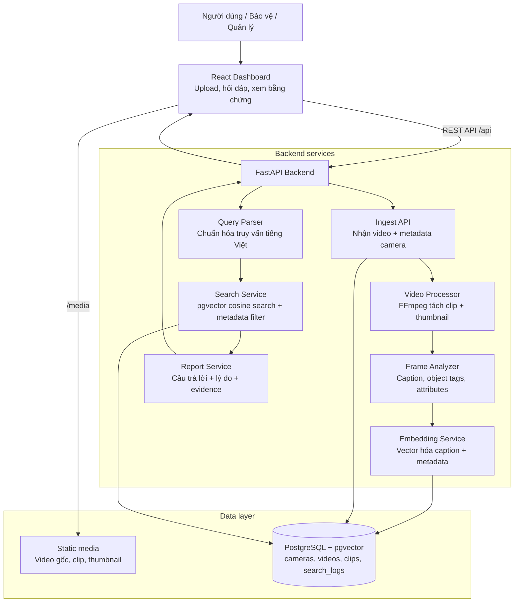
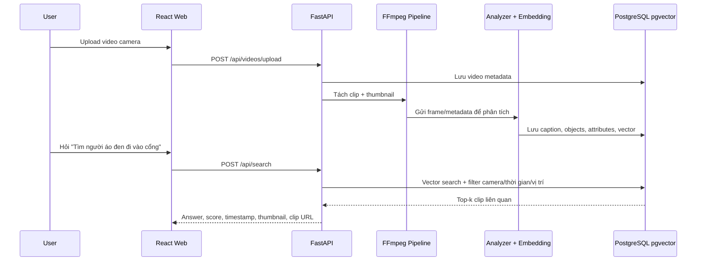
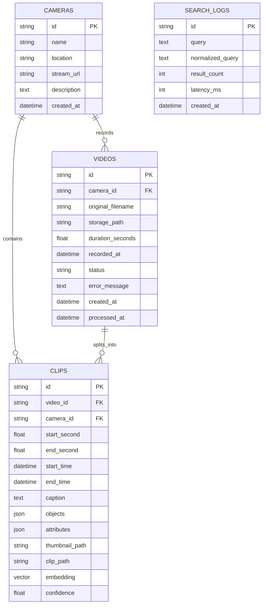

# SafeCam AI Assistant

Trợ lý AI tìm kiếm và phân tích sự kiện trong video camera an ninh, được dựng từ ý tưởng trong file `Y_tuong_2_Tro_ly_AI_Camera_An_ninh.pdf`.

## Stack

- Backend: FastAPI, SQLAlchemy, FFmpeg, PostgreSQL + pgvector.
- Frontend: React, Vite, TypeScript.
- Database mặc định: PostgreSQL 16 local trong Docker với extension `vector`.
- Deploy local: Docker Compose gồm `db`, `api`, `web`.

## Sơ đồ kiến trúc



## Luồng xử lý



## Sơ đồ database



## Database local hay Supabase?

Mặc định repo này đang dùng PostgreSQL local trong Docker Compose, service `db` dùng image `pgvector/pgvector:pg16`. Đây chưa phải Supabase.

Supabase cũng là PostgreSQL, nên có thể dùng Supabase thay cho database local nếu project Supabase đã bật extension `vector`. Khi đó chỉ cần set `DATABASE_URL` trong `.env`:

```bash
DATABASE_URL=postgresql+psycopg://postgres:<password>@<supabase-host>:5432/postgres
```

Sau đó chạy backend như bình thường. Lưu ý `MEDIA_ROOT` vẫn lưu video/thumbnail/clip ở filesystem hoặc Docker volume; Supabase ở cấu hình này chỉ thay phần PostgreSQL, chưa thay phần lưu file bằng Supabase Storage.

## Chạy nhanh bằng Docker

```bash
cp .env.example .env
docker compose up --build
```

Mở dashboard tại [http://localhost:8080](http://localhost:8080).

API chạy tại [http://localhost:8000/api/health](http://localhost:8000/api/health).

## Cách dùng demo

1. Mở dashboard.
2. Upload một video camera `.mp4`, `.mov`, `.mkv`, `.avi`, `.webm`.
3. Chờ trạng thái video chuyển sang `processed`.
4. Nhập truy vấn như `Tìm người áo đen đi vào cổng chính`.
5. Bấm một kết quả để xem thumbnail, clip và timestamp.

## Chạy từng thư mục

Chạy database bằng Docker:

```bash
docker compose up -d db
```

Backend:

```bash
cd backend
python3 -m venv .venv
source .venv/bin/activate
pip install -r requirements.txt
uvicorn app.main:app --reload --host 0.0.0.0 --port 8000
```

Frontend:

```bash
cd frontend
npm install
VITE_API_BASE_URL=http://localhost:8000 npm run dev
```

Frontend dev server sẽ chạy ở [http://localhost:5173](http://localhost:5173).

## Lệnh tiện ích

```bash
make docker-up
make docker-down
make test-backend
make build-frontend
```

## API chính

- `GET /api/health`: kiểm tra API và database.
- `GET /api/stats`: thống kê camera, video, clip.
- `GET /api/cameras`: danh sách camera.
- `POST /api/videos/upload`: upload video, form-data gồm `file`, `camera_id`, `location`, `recorded_at`, `process_now`.
- `POST /api/videos/{id}/process`: xử lý lại video.
- `GET /api/clips`: danh sách clip đã phân tích.
- `POST /api/search`: tìm kiếm bằng câu hỏi tiếng Việt.
- `POST /api/reports/summary`: tạo báo cáo ngắn từ kết quả truy vấn.

## Ghi chú về AI

Bản MVP hiện dùng analyzer local nhẹ để demo luồng upload -> split clip -> caption -> embedding -> vector search. Muốn nâng độ chính xác, thay `backend/app/services/frame_analyzer.py` bằng YOLO/VLM và thay `HashingEmbedding` trong `backend/app/services/embedding.py` bằng CLIP hoặc sentence-transformers.

Schema database và API đã được thiết kế để đổi model mà không phải viết lại dashboard.

## GitHub

Repo đã được tạo trên account `thangak18`: [https://github.com/thangak18/Camera-AI](https://github.com/thangak18/Camera-AI).
