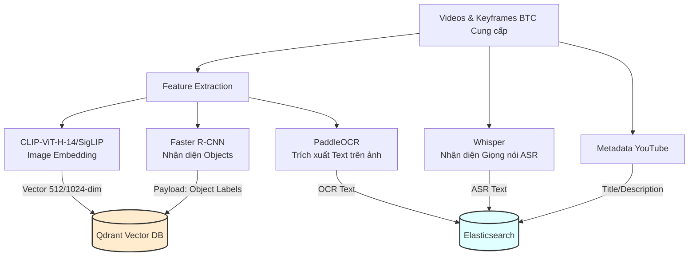
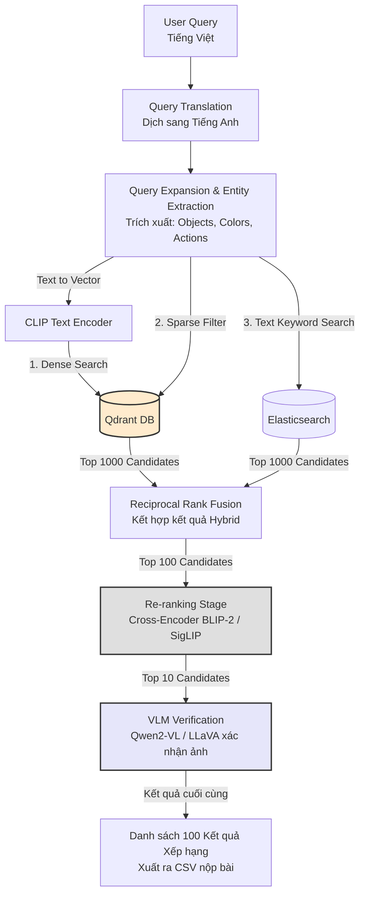

# AIC 2026 Video Retrieval System

Hệ thống AI tìm kiếm và truy xuất sự kiện trong video đa phương thức, được thiết kế và tối ưu riêng cho cuộc thi **Hội thi Thử thách Trí tuệ Nhân tạo TP.HCM năm 2026 (AIC 2026)**. Trái tim của hệ thống sử dụng **Qdrant** Vector Database kết hợp quy trình Re-ranking và VLM tiên tiến.

---

## 1. Mục tiêu giải quyết (Theo đề thi AIC 2026)

Hệ thống được thiết kế để giải quyết 3 dạng truy vấn chính của vòng sơ tuyển:

1. **Truy vấn dạng 1 (Textual KIS)**: Tìm kiếm sự kiện chính xác theo văn bản.
   - Đầu vào: Mô tả văn bản tự nhiên.
   - Đầu ra: `video_id`, `frame_id`.
2. **Truy vấn dạng 2 (Video Q&A)**: Tìm kiếm sự kiện và trả lời câu hỏi.
   - Đầu vào: Mô tả sự kiện và câu hỏi cụ thể.
   - Đầu ra: `video_id`, `frame_id`, `answer`.
3. **Truy vấn dạng 3 (TRAKE)**: Truy xuất và căn chỉnh sự kiện video theo thời gian.
   - Đầu vào: Chuỗi sự kiện có cấu trúc gồm $N$ bước.
   - Đầu ra: `video_id` và danh sách các `frame_id` (semantic keyframes) tương ứng theo thứ tự thời gian tăng dần (`frame_id_1 < frame_id_2 < ... < frame_id_N`).

---

## 2. Công thức Đánh giá & Chấm điểm (Scoring Metric)

BTC chấm điểm tối đa 100 câu trả lời nộp về cho mỗi truy vấn theo tiêu chí:
- **Điểm Tương Quan ($R\text{-Score}$)**: Đánh giá câu trả lời đúng hay sai (giá trị 0 đến 1).
  - *Textual KIS*: Đúng `video_id` và `frame_id` nằm trong đoạn $[s, e]$.
  - *Q&A*: Đúng `video_id`, `frame_id` trong $[s, e]$ và đúng ngữ nghĩa `answer`.
  - *TRAKE*: Đúng `video_id` (sai là 0 điểm ngay) và tỉ lệ các bước nộp đúng $[s_j, e_j]$.
- **Điểm Cuối Cùng ($\text{Final Score}$)**: Trung bình cộng $R\text{-Score}$ cao nhất trong Top-$k$ ($k \in \{1, 5, 20, 50, 100\}$):
  $$\text{Final Score} = \frac{R@1 + R@5 + R@20 + R@50 + R@100}{5}$$

> 💡 **Chiến lược:** Vì $R@1$ và $R@5$ chiếm tỉ trọng điểm rất lớn, hệ thống **bắt buộc phải có khâu Re-ranking** để đẩy câu trả lời chính xác nhất lên vị trí số 1.

---

## 3. Kiến trúc Hệ thống & Pipeline

Hệ thống hoạt động theo 2 pha: **Offline** (chuẩn bị dữ liệu) và **Online** (truy vấn thời gian thực).

### 3.1. OFFLINE PIPELINE (Data Ingestion & Indexing)
Xử lý toàn bộ video/keyframes mà BTC cung cấp và nạp vào Vector DB & Text Engine.



### 3.2. ONLINE PIPELINE (Query Processing & Retrieval)
Chạy realtime khi người dùng nhập câu hỏi truy vấn, áp dụng Re-ranking khắt khe.



---

## 4. Stack Công Nghệ

- **Vector Database**: **Qdrant** (Thay thế PostgreSQL/pgvector để tăng tốc độ truy xuất hàng triệu vector & hỗ trợ Payload filtering mạnh mẽ).
- **Text Search**: **Elasticsearch** (Tìm kiếm OCR text, ASR, Metadata).
- **Embeddings**: OpenCLIP (`ViT-H-14`) hoặc SigLIP.
- **Re-ranker**: BLIP-2 ITM hoặc Cross-Encoder.
- **VLM (Vision-Language Model)**: **Qwen2-VL-7B** (chạy local GPU) hoặc GPT-4o / Gemini API.
- **Backend API**: Python (FastAPI, Uvicorn, qdrant-client).
- **Frontend / Dashboard**: React.js hoặc Streamlit.
- **Deploy**: Docker Compose.

---

## 5. Quy chuẩn API (API Specification)

Backend cung cấp các REST API cho Frontend hoặc Script Submit:

### 5.1. KIS Search
`POST /api/search/kis`
```json
// Request
{ "query": "Tìm video về một diễn giả mặc áo đỏ phát biểu ngoài trời" }

// Response
{
  "results": [
    { "rank": 1, "video_id": "L01_V001", "frame_id": 1500, "score": 0.92 },
    { "rank": 2, "video_id": "L01_V002", "frame_id": 820, "score": 0.88 }
  ]
}
```

### 5.2. Q&A Search
`POST /api/search/qa`
```json
// Request
{
  "description": "Trong video về lễ trao giải thưởng âm nhạc",
  "question": "Có bao nhiêu người lên sân khấu nhận giải?"
}

// Response
{
  "results": [
    { "rank": 1, "video_id": "L05_V005", "frame_id": 3450, "answer": "5", "score": 0.95 }
  ]
}
```

### 5.3. TRAKE Search
`POST /api/search/trake`
```json
// Request
{
  "events": [
    "Vận động viên chạy đà",
    "Vận động viên giậm nhảy",
    "Vận động viên bay qua xà",
    "Vận động viên tiếp đất"
  ]
}

// Response
{
  "results": [
    {
      "rank": 1,
      "video_id": "L10_V010",
      "frame_ids": [101, 150, 203, 251],
      "score": 0.89
    }
  ]
}
```

---

## 6. Cấu trúc Thư mục Dự án

```text
AIC26-multimodal-video-retrieval/
├── src/                  # Code lõi pipeline (ingestion, retrieval, reranking, vlm, trake, api)
├── scripts/
│   └── download_data.py # Script tự động tải bộ dữ liệu AIC 2026 từ file Excel BTC cấp
├── data/
│   └── v1/
│       ├── videos/          # Video gốc từ BTC (.mp4)
│       ├── keyframes/       # Ảnh cắt từ video (.jpg)
│       ├── objects/         # JSON chứa object detected (Faster R-CNN)
│       ├── clip_features/   # File .npy CLIP ban đầu
│       └── metadata/        # JSON YouTube
├── notebooks/
│   └── v1/               # Notebook thử nghiệm, hướng dẫn truy vấn dữ liệu bằng FiftyOne
├── outputs/
│   └── v1/
│       ├── submissions/  # CSV kết quả nộp bài
│       └── eval/         # Kết quả chấm R-Score nội bộ
├── docs/
│   ├── src-overview.md   # Mô tả vai trò từng module trong src/
│   ├── v1/                # Đề bài và manifest dữ liệu của vòng hiện tại
│   └── papers/             # Paper tham khảo cho video retrieval/reranking
└── README.md
```

Thư mục `data/`, `outputs/` chứa dữ liệu/kết quả sinh ra, không commit vào git. Mỗi vòng thi mới sẽ có thư mục con riêng (`v2/`, `v3/`...) cạnh `v1/` trong `data/`, `notebooks/`, `outputs/`, `docs/`, trong khi `src/` dùng chung và tiến hoá liên tục qua các vòng.

---

## 7. Hướng dẫn Cài đặt & Khởi chạy Nhanh

### Bước 1: Tải bộ dữ liệu AIC 2026
Cài dependency và chạy script Python để tự động tải bộ dữ liệu (~115GB):
```bash
python3 -m venv .venv
source .venv/bin/activate
pip install -r requirements.txt

python scripts/download_data.py
```

### Bước 2: Khởi chạy Qdrant DB bằng Docker
```bash
docker run -d -p 6333:6333 -p 6334:6334 -v $(pwd)/qdrant_storage:/qdrant/storage qdrant/qdrant
```

### Bước 3: Nạp dữ liệu vào Qdrant (Ingestion)
```bash
python scripts/01_ingest.py
```
> Chưa triển khai — xem checklist ở mục 8.

### Bước 4: Chạy Backend (FastAPI)
```bash
uvicorn backend.app.main:app --reload --host 0.0.0.0 --port 8000
```
> Chỉ cần cho **web UI** và **vòng thi trực tiếp**. Sinh bài nộp KHÔNG cần bước
> này — xem Bước 6. Swagger UI tại [http://localhost:8000/docs](http://localhost:8000/docs).

### Bước 5: Chạy Frontend (React)

URL backend đọc từ biến môi trường, **không sửa code**. Tạo `frontend/.env.local`
(đã nằm trong `.gitignore`):

```
VITE_API_BASE_URL=https://thick-yaks-unite.loca.lt
```

Rồi:
```bash
cd frontend
npm install
npm run dev
```

> Bỏ trống hoặc không tạo file thì mặc định là `http://localhost:8000`.
> Localtunnel đổi tên mỗi lần Kaggle khởi động lại — sửa đúng một dòng trong
> `.env.local` rồi `npm run dev` lại, không phải đụng vào `App.jsx`.

### Bước 6: Sinh bài nộp (đêm thi)

Chạy **ngay trên máy có dữ liệu**, không qua API, không qua localtunnel, không
cần commit/push gì trước.

```bash
cp .env.example .env          # rồi điền GEMINI_API_KEY
python scripts/preflight.py   # kiểm điều kiện — chạy TRƯỚC khi đề về

# đề về:
python scripts/generate_submission.py --query_dir <thư-mục-đề>
python scripts/validate_submission.py --zip submission.zip --query_dir <thư-mục-đề> --map_dir data/v1/map_keyframes
```

Cả hai script trả **exit code khác 0** khi còn vấn đề. Chi tiết từng truy vấn
nằm ở `outputs/submission_report.json`: số dòng, số video, thời gian, trạng
thái circuit breaker, và mọi dấu hiệu suy giảm.

**Thứ tự đọc khi có cảnh báo:** `[X]` là file hỏng/thiếu — phải sửa. `[!]` là
file vẫn ghi được nhưng suy giảm (thiếu dòng, Q&A toàn `khong ro`, TRAKE lặp
một frame). Thể lệ chỉ cho nộp 3 lần mỗi gói và lấy điểm lần **cuối**, nên
không được "nộp thử xem sao".

**Điều kiện cần** (`preflight.py` kiểm đủ): `data/v1/{keyframes,map_keyframes,
siglip_features}` đầy đủ · mạng tới Qdrant Cloud · `GEMINI_API_KEY` trong
`.env`. Elasticsearch là tuỳ chọn — không có thì searcher tự bỏ nhánh keyword.
GPU cũng không bắt buộc: đo trên CPU được 0,28s/truy vấn cho khâu SigLIP.

**Công tắc nhanh khi có sự cố** — đặt trong `.env`, không phải sửa code:

| Tình huống | Đặt |
|---|---|
| Gemini 503 hàng loạt, muốn chạy nhanh | `AIC_RERANK_STAGE_B=0` |
| Vòng thi trực tiếp bị bấm giờ | `AIC_PROFILE=live` (đổi cả bộ ngân sách + tắt Stage B) |
| Chạy qua localtunnel, Dạng 2 bị ngắt | `AIC_QA_DEADLINE=90` |

> **Chỉ có một đường sinh bài nộp.** `scripts/deploy_kaggle.ipynb` cố ý KHÔNG
> có cell sinh submission: hai đường song song sẽ cho ra hai `submission.zip`
> từ hai thời điểm, có thể từ hai phiên bản code khác nhau, và không phân biệt
> được lúc đang vội. Notebook đó giờ chỉ để dựng API cho web UI / vòng thi
> trực tiếp. Nếu máy local thật sự hỏng, notebook có hướng dẫn chạy **đúng
> script này** trên Kaggle — cùng code, không có nhánh riêng nào để lệch pha.

---

## 8. Lộ trình Triển khai (Checklist)

- [x] **Kế hoạch & Architecture**: Chọn Qdrant, thiết kế Online/Offline pipeline và Re-ranking strategy.
- [x] **Data Downloader**: Viết script `download_data.py` tự động đọc file Excel và tải bộ dữ liệu Batch 1.
- [ ] **Data Ingestion**: Nạp toàn bộ dữ liệu CLIP features & Object labels của BTC vào Qdrant.
- [ ] **Base Search API**: Hoàn thiện API `/api/search/kis` trả kết quả search cơ bản từ Qdrant.
- [ ] **Re-ranking Engine**: Tích hợp BLIP-2 Cross-Encoder đẩy Top-1 R-Score.
- [ ] **VLM Module**: Gọi Qwen2-VL / Gemini API cho câu hỏi Q&A.
- [ ] **TRAKE DP Solver**: Thuật toán ràng buộc chuỗi thời gian tăng dần cho TRAKE.
- [ ] **Evaluation Script**: Tính điểm $R\text{-Score}$ và $\text{Final Score}$ tự động.
