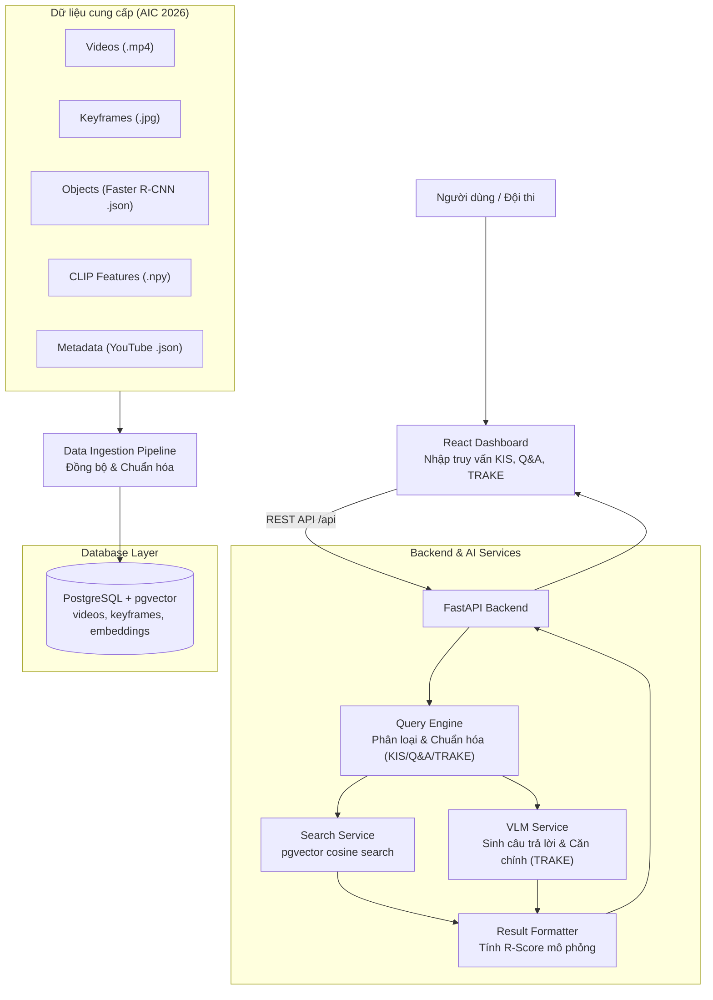
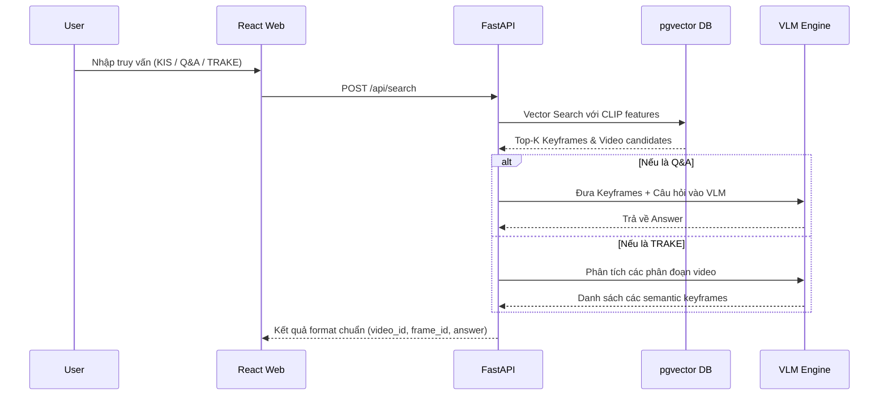

# AIC 2026 Video Retrieval System

Hệ thống AI tìm kiếm và truy xuất sự kiện trong video, được thiết kế và tối ưu riêng cho cuộc thi **Hội thi Thử thách Trí tuệ Nhân tạo TP.HCM năm 2026 (AIC 2026)**.

## Mục tiêu giải quyết theo đề thi AIC 2026

Hệ thống được thiết kế để giải quyết 3 dạng truy vấn chính của vòng sơ tuyển:

1. **Truy vấn dạng 1 (Textual KIS)**: Tìm kiếm sự kiện chính xác theo văn bản.
   - Đầu vào: Mô tả văn bản.
   - Đầu ra: `video_id`, `frame_id`.
2. **Truy vấn dạng 2 (Video Q&A)**: Tìm kiếm sự kiện và trả lời câu hỏi.
   - Đầu vào: Mô tả sự kiện và câu hỏi cụ thể.
   - Đầu ra: `video_id`, `frame_id`, `answer`.
3. **Truy vấn dạng 3 (TRAKE)**: Truy xuất và căn chỉnh sự kiện video theo thời gian.
   - Đầu vào: Chuỗi sự kiện có cấu trúc.
   - Đầu ra: `video_id` và danh sách các `frame_id` (semantic keyframes) tương ứng.

## Stack Công Nghệ

- **Backend**: FastAPI, SQLAlchemy, FFmpeg.
- **AI Models**: 
  - **Vector Search**: Sử dụng trực tiếp CLIP features (clip-ViT-B-32) do BTC cung cấp.
  - **Vision-Language Model (VLM)**: Xử lý dạng Q&A và hỗ trợ nhận diện chuỗi sự kiện TRAKE.
- **Frontend**: React, Vite, TypeScript, TailwindCSS.
- **Database**: PostgreSQL 16 + pgvector (Lưu trữ và query CLIP embeddings, objects, metadata).
- **Deploy**: Docker Compose.

## Sơ đồ kiến trúc (Theo chuẩn AIC 2026)



## Luồng xử lý Truy Vấn



## Database (PostgreSQL + pgvector) hay Supabase?

Mặc định repo sử dụng PostgreSQL local trong Docker Compose với extension `pgvector`.
Có thể chuyển đổi dễ dàng sang Supabase bằng cách thay đổi `DATABASE_URL` trong file `.env`:

```bash
DATABASE_URL=postgresql+psycopg://postgres:<password>@<supabase-host>:5432/postgres
```

## Chạy nhanh bằng Docker

```bash
cp .env.example .env
# Cấu hình các đường dẫn đến dataset của BTC trong .env nếu cần
docker compose up --build
```

- Mở dashboard tại [http://localhost:8080](http://localhost:8080)
- Kiểm tra API tại [http://localhost:8000/api/health](http://localhost:8000/api/health)

## Chạy thủ công từng service

### Database:
```bash
docker compose up -d db
```

### Backend:
```bash
cd backend
python3 -m venv .venv
source .venv/bin/activate
pip install -r requirements.txt
uvicorn app.main:app --reload --host 0.0.0.0 --port 8000
```

### Frontend:
```bash
cd frontend
npm install
VITE_API_BASE_URL=http://localhost:8000 npm run dev
```

## Ghi chú về Tích hợp Dữ Liệu AIC

- Thay vì tự tách frame và trích xuất đặc trưng bằng FFmpeg/Model từ đầu như các hệ thống thông thường, backend sẽ ưu tiên đọc trực tiếp từ các file `.npy` (CLIP features) và `.json` (Objects, Metadata) do BTC cung cấp để tiết kiệm thời gian và đảm bảo độ chính xác khi chấm điểm.
- API sẽ có luồng riêng để đánh giá (evaluate) theo công thức tính **R-Score** (Top-1, 5, 20, 50, 100) của BTC.

## GitHub

Repo đã được tạo trên account `thangak18`: [https://github.com/thangak18/Camera-AI](https://github.com/thangak18/Camera-AI).
